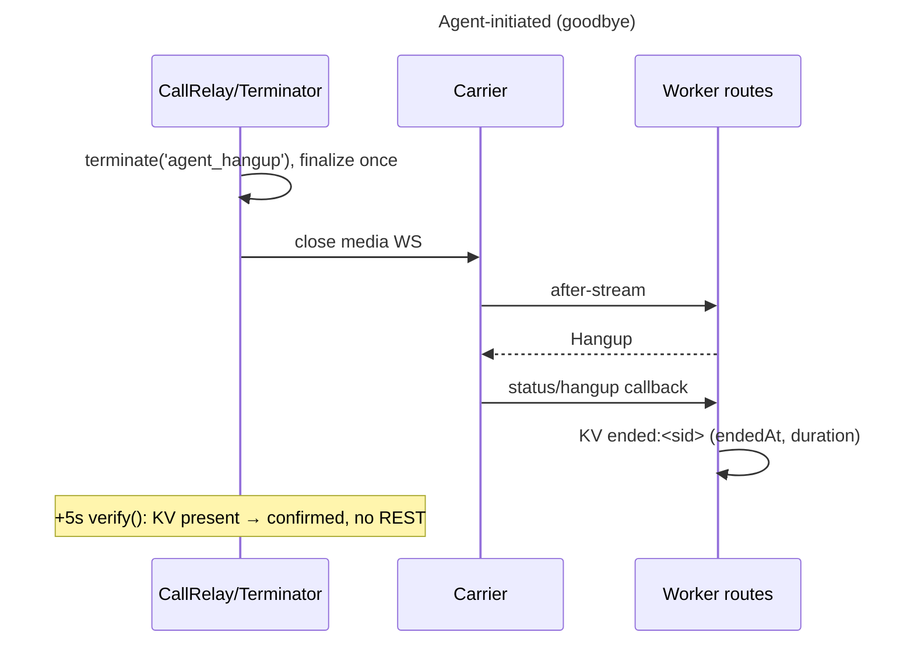
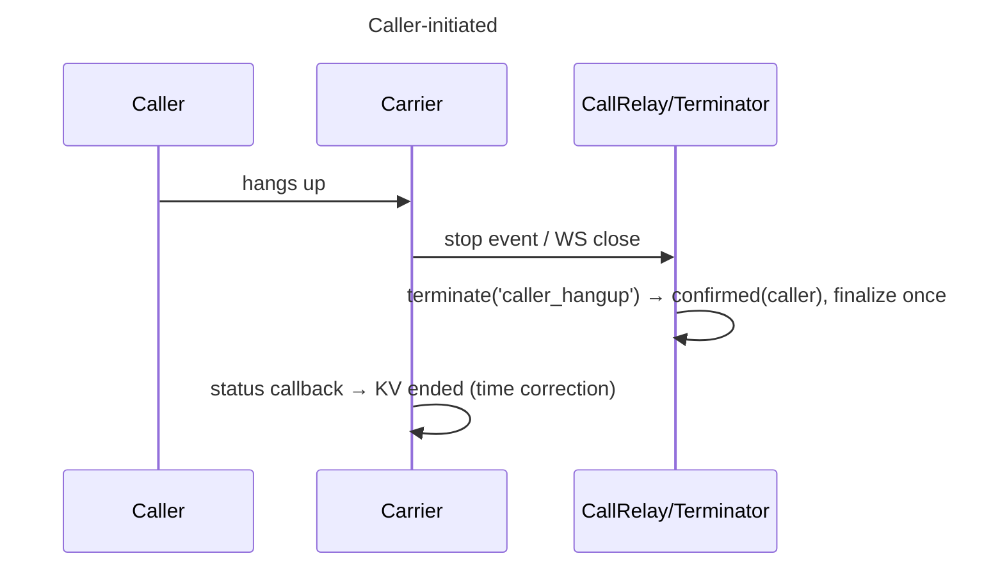

# Call termination: design (Phase 1, for review)

Status: DRAFT for orchestrator review. Nothing is implemented. Carrier-doc claims are marked
**UNVERIFIED** where I did not check the carrier docs (this session read code only).

## 1. Current state

Every end path in `call-relay.ts` funnels into `hangUp(reason)` (~l.976), which does
`finalize(reason)` (records written once, guarded by `this.finalized`) then
`this.twWs.close(1000, …)` **only if the socket is OPEN**. That is the whole hang-up. There is no carrier REST call and nothing checks that the leg ended.

| Our trigger | Code | What the carrier does next (needs after-stream to fire) |
|---|---|---|
| Agent goodbye (`endCall`) | `hangUp('agent_hangup')` | close WS → fetch `/…/after-stream` |
| Silence / max-duration / dead-media guards | `guardTick` → `hangUp(...)`; DO `alarm()` backstop | same |
| Transfer | `hangUp('transfer')`; staff number in KV `transferKey(callSid)` | after-stream returns Dial / `200` (Connect applet) |
| Caller hangs up | carrier sends `stop` or closes WS → `finalize('caller_hangup')` | carrier ends the leg itself; nothing for us to do |
| Network drop / STT failure | `webSocketClose`/`finalize`; STT failure closes 1011 | WS gone; carrier proceeds as if we closed |

Per carrier, what ends the line:
- **Twilio**: `/twilio/inbound` returns `<Connect><Stream url=…/></Connect><Redirect method="POST">…/twilio/after-stream</Redirect>`. When the WS closes, Twilio moves to `<Redirect>`; `/twilio/after-stream` returns `<Response><Hangup/></Response>` (or `<Dial>` on transfer). Depends on: the closed WS ending `<Connect>` (documented behaviour, UNVERIFIED here) and `requireTwilioSig` passing. `TWILIO_WEBHOOK_URL` must match the public URL exactly or the signature check 403s and the call ends with an application error instead of a clean hangup (it still ends, but not cleanly).
- **Plivo**: `/plivo/answer` returns `<Stream bidirectional="true" keepCallAlive="true" …/><Redirect>…/plivo/after-stream</Redirect>`; after-stream returns `<Hangup/>`. `keepCallAlive="true"` holds the call on the Stream until the socket closes, then runs the Redirect (UNVERIFIED). `/plivo/hangup` only logs.
- **Exotel**: no XML. The flow is Voicebot applet → Passthru applet (`/exotel/after-stream`): `200` → Connect applet (transfer), `302` → Hangup applet. This depends on the **flow configured in the Exotel dashboard**, which we cannot see from code. If the Passthru/Hangup applets are missing or mis-wired, nothing ends the call.
- Status callbacks: Twilio `/twilio/status` and Plivo `/plivo/hangup` exist but only classify/log; **Exotel has no status endpoint**. None write an authoritative end time.

## 2. Failure modes that leave a call up (most likely first)

1. **Exotel flow wiring.** Voicebot's next applet is not Passthru→Hangup (or 302 isn't mapped to Hangup); the flow loops back, plays nothing and holds the line. Confirm: operator call view shows `end_reason` set (we think we hung up) and `duration` short, while the Exotel call log shows the leg lasting minutes with no Hangup applet in its trace.
2. **`hangUp` skipped because `twWs` is not OPEN.** After DO eviction/hibernation (the `alarm()` backstop path) `this.twWs` is gone and `hangUp` closes nothing: records are finalised, the line stays. Same if the socket is `CLOSING`. Confirm: `end_reason = max_duration` with carrier log duration far above the cap.
3. **Close sent, carrier ignores it.** Plivo `keepCallAlive` semantics, or Twilio not leaving `<Connect>` on a server close (both UNVERIFIED). Confirm: `call.hangup` log line present, but no `GET/POST /…/after-stream` request in the Worker logs for that call id within seconds.
4. **after-stream unreachable** (Worker error, wrong `TWILIO_WEBHOOK_URL`/signature). For Twilio/Plivo this normally ends the call with an error; for Exotel a failed Passthru can fall through the flow. Confirm: 4xx/5xx on `/…/after-stream` in logs; Twilio debugger 11200/11205.
5. **Transfer path left up**: after-stream finds the KV key but the staff leg never connects and the Connect applet/`<Dial>` holds the original leg. Bounded by Dial timeout 25s on Twilio/Plivo; Exotel `max_ringing_duration` 25.

Opposite direction (caller hang-up): `stop` and `webSocketClose` both call `finalize('caller_hangup')`; `finalized` makes it exactly-once, and `dead_media` (no audio for `deadMediaMs`) covers a carrier that dies silently. Gap: end time/duration come from `Date.now()` at finalise, not the carrier, so billed minutes can differ from the carrier's.

## 3. Proposed architecture: `CallTerminator`

One small class per call, owned by `CallRelay`, in `worker/src/telephony/terminator.ts`. Carrier REST specifics live in the three telephony adapters (`hangupRest(callSid)`, `statusRest(callSid)`), keeping `CallRelay` carrier-agnostic.

**a. Primary path.** `terminate(reason)`: state `idle → requested`. Set once (idempotent: later calls return). `finalize(reason)`, abort the active turn, close the WS if open (as today). Persist `{callSid, provider, requestedAt, reason}` to DO storage so it survives eviction. Fixes mode 2: no dependence on the live socket.

**b. Guaranteed path (REST hangup).** After `VERIFY_AFTER_MS` (5 s, env `VOICE_HANGUP_VERIFY_MS`) the DO alarm fires `verify()`:
- Twilio: `POST /2010-04-01/Accounts/{sid}/Calls/{CallSid}.json` with `Status=completed` (auth: `TWILIO_ACCOUNT_SID` + `TWILIO_AUTH_TOKEN`). An already-ended call returns an error we treat as "confirmed ended".
- Plivo: `DELETE /v1/Account/{auth_id}/Call/{uuid}/` (auth `PLIVO_AUTH_ID`:`PLIVO_AUTH_TOKEN`); 404 = already ended.
- Exotel: **no documented hangup API for a live call that I know of (UNVERIFIED)**. `verify()` instead reads call status via `GET https://{EXOTEL_SUBDOMAIN}/v1/Accounts/{EXOTEL_ACCOUNT_SID}/Calls/{sid}.json` (existing `EXOTEL_*` creds). If still `in-progress`: log `call.hangup_unconfirmed` (alert, §3g). Mitigation: owner audits the flow (checklist in §5) and we add a Hangup applet on every Passthru branch including error/timeout; if Exotel confirms a hangup API, `hangupRest` is added without redesign.
- Never fired for `reason = 'transfer'` (it would kill the staff hand-off); for transfer we only verify that after-stream was fetched.

**c. Verification.** Before any REST call, `verify()` checks KV `ended:<callSid>`, written by the carrier callbacks (Twilio `/twilio/status` completed, Plivo `/plivo/hangup`). Present → `carrier_confirmed` via callback, no REST. Absent → REST hangup, then re-check once after 3 s; still up → `call.hangup_unconfirmed`. (KV rather than DO messaging, because the DO is addressed by a random id, not by callSid.)

**d. Idempotency.** State machine `idle → requested → confirmed` persisted; every trigger (guards, goodbye, caller `stop`, alarm, `webSocketClose`) calls `terminate()`; only the first transition acts; REST hangup is sent at most twice (one retry on 5xx/network). `finalize()` already runs once. A caller hang-up goes straight to `confirmed (caller)` and skips REST.

**e. Source of truth for time.** The callbacks also store `{endedAt, duration}` in `ended:<callSid>` (Twilio `Timestamp`/`CallDuration`, Plivo `Duration`/`EndTime`). Usage is flushed on finalise as now, then **corrected** by a small update (`usage` row `durationSeconds`, `endedAt`) when the callback arrives, if it differs by >2 s. This is the only part touching billing data, so it is flagged for orchestrator review; if unwanted, ship without it and keep a log only.

**f. Logs/metrics.** Structured events via `logEvent`: `call.hangup_requested {reason}`, `call.hangup_method {ws_close|rest|callback}`, `call.hangup_confirmed {ms_to_confirm, by}`, `call.hangup_rest_error {status}`. New nullable column on `call_outcomes` (migration `0033`): `hangup_method`, `hangup_confirm_ms`, so the operator view can show it next to `end_reason`.

**g. Alert.** A second alarm at `maxMs + CAP_GRACE_MS + 60 s` (extends the existing backstop alarm): if not `confirmed`, REST hangup and log `call.hangup_unconfirmed` at `error` level (Exotel: log only). Surfacing the alert in the existing alerting path is left to the owner's current setup; I will only emit the log line.

### Sequences



```mermaid
sequenceDiagram
  title Guard-initiated, carrier ignores close
  participant R as CallRelay/Terminator
  participant C as Carrier
  R->>R: terminate('silence'|'max_duration'|'dead_media'), persist state
  R->>C: close WS (or skip if socket gone)
  Note over C: no after-stream, line stays up
  R->>R: +5s verify(): no KV ended
  R->>C: REST hangup (Twilio POST / Plivo DELETE)
  C-->>R: 200 (or 404 = already ended)
  R->>R: +3s re-check; log hangup_confirmed or hangup_unconfirmed
```



## 4. Secrets, limits, failure handling

- Twilio: `TWILIO_ACCOUNT_SID`, `TWILIO_AUTH_TOKEN` (already exist). Plivo: `PLIVO_AUTH_ID`, `PLIVO_AUTH_TOKEN` (exist; today "live check only", the `checkOnly` label in `integrations.ts` changes). Exotel: `EXOTEL_ACCOUNT_SID/API_KEY/API_TOKEN/SUBDOMAIN` (exist). **No new secrets.** If a business lacks its carrier's REST creds, the terminator skips REST, logs `call.hangup_no_credentials` (warn), and behaves as today.
- Rate limits: one REST call per call end, plus at most one retry and one status read. Well inside carrier API limits at current volume; Twilio/Plivo throttle only at tens of requests/s per account.
- REST error: 5xx/timeout → one retry after 2 s; 4xx "already ended" → confirmed; 401/403 → log `error`, no retry; never throws into the call path (all under `ctx.waitUntil`, 5 s timeout). Secrets never logged.

## 5. Test plan

- **Unit**: terminator state machine (idempotent under concurrent triggers; transfer skips REST; no-credentials path; error mapping per carrier); adapter request shape (URL, method, auth header, body) per carrier.
- **e2e**: add a carrier-mock option `ignoreClose` (after-stream never fetched). Assert for Twilio and Plivo: guard fires → close → mock records exactly one REST hangup; with the default mock (fetches after-stream + posts callback) assert **zero** REST calls; caller-hangup scenario asserts zero REST; transfer asserts zero REST; Exotel `ignoreClose` asserts `hangup_unconfirmed` is logged. Add a "socket already gone" scenario for the alarm path.
- **Owner live script** (per carrier, one real call to your own phone; no calls to patients): (1) call the line, say nothing → expect the agent to hang up after the silence timeout; in the carrier call log the leg ends at that moment, duration ≈ operator view. (2) say "goodbye" → agent hangs up after the farewell. (3) hang up yourself → one `caller_hangup`, no REST. (4) Exotel only: audit the flow (Voicebot → Passthru; Passthru 200 → Connect, else → Hangup; no applet after Hangup) then repeat 1–3. Check in logs: `call.hangup_requested`, `call.hangup_confirmed` with `by` = callback or rest.

## 6. Rollout

No flag (bug fix). Log events in §3f confirm behaviour in production: in the first week, count `by=rest` per carrier. Any `by=rest` means the primary path was failing silently and tells us which carrier/reason; `hangup_unconfirmed` is the page-worthy case. The only data change is migration `0033` (two nullable columns) and, if approved, the usage time correction in §3e.

## Open questions for the orchestrator

1. Approve §3e (rewrite usage `durationSeconds` from carrier time)? Billing-adjacent.
2. Exotel: accept "verify + alert + flow audit" until a hangup API is confirmed (I can't confirm one from code)?
3. Is the 5 s verify delay acceptable (caller on a silent line ≤ ~5 s in the worst case)?
