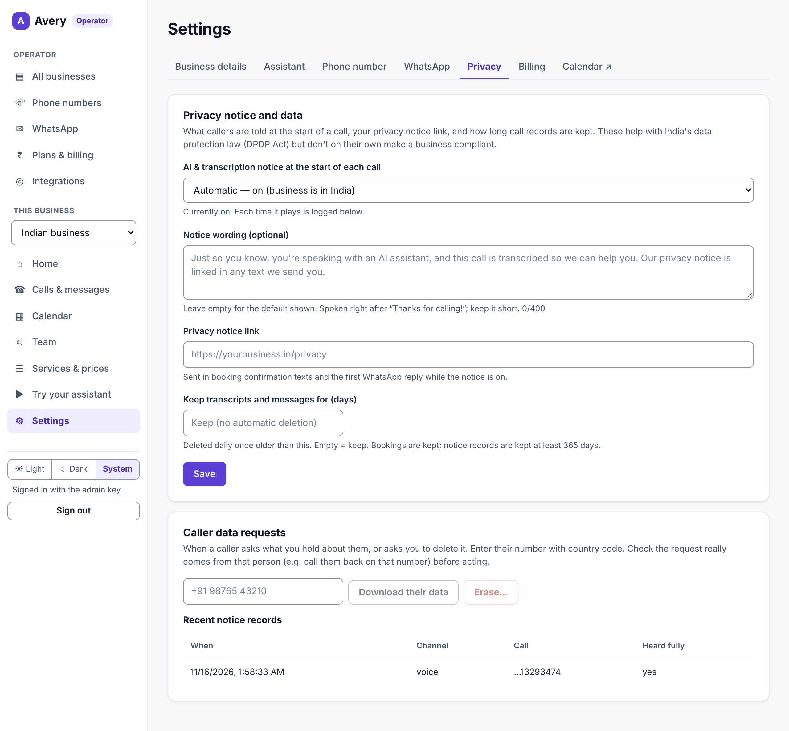
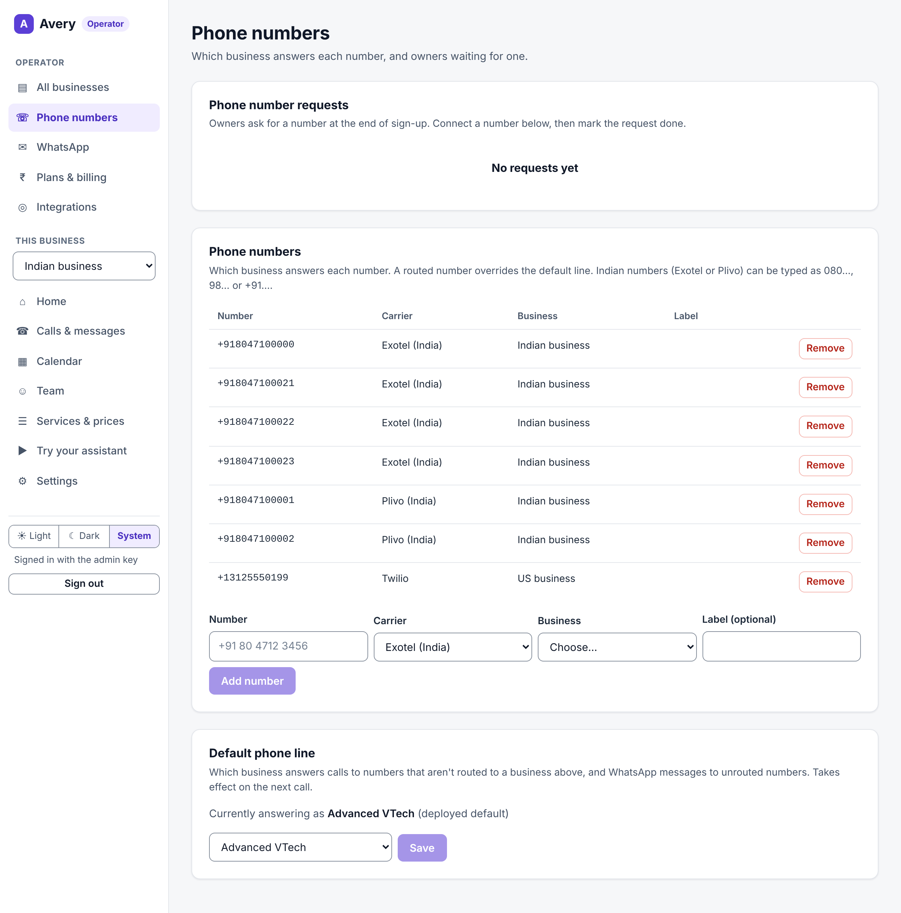
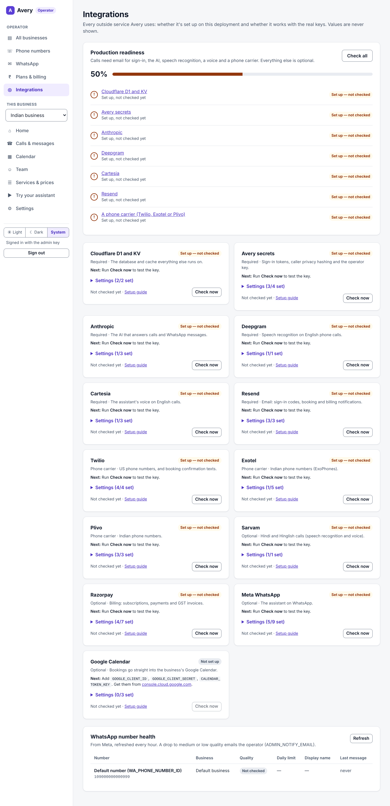
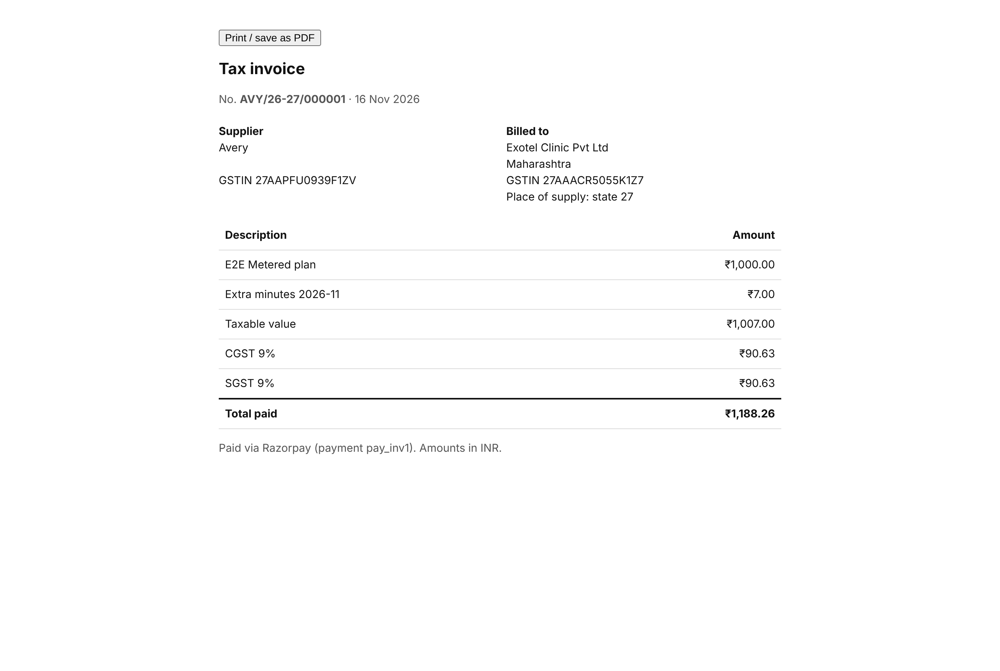

# DeskZen trust one-pager: privacy, phone lines, GST billing

Polished private version (Artifact): https://claude.ai/artifact/7dZCSYVyWFHYSQ9QR9jj2m

For clinic owners and their advisers. Everything below is what the product does today. Where
something is configured per clinic, or hasn't been proven on a live line yet, it says so.

## 1. DPDP: patients are told, and it's recorded

- **At the start of every call** in India, the assistant says that the caller is speaking with an
  AI assistant and that the call is transcribed, in the clinic's language (English, Hindi,
  Hinglish, Kannada, Telugu or Tamil). On WhatsApp, the first reply carries the same notice.
- **Each notice is logged** as a consent record: when it played, on which call, whether the caller
  heard it fully, and which wording version was used (Settings → Privacy → *Recent notice
  records*, screenshot above). Records are kept at least 365 days.
- **Patients' rights:** the clinic can export everything held about a phone number, or erase it,
  from Settings → Privacy. Each request is logged.
- **Retention:** the clinic sets how long transcripts and messages are kept. A daily job deletes
  older ones.
- **Opt-out:** a patient who replies STOP gets no reminders, recalls or review requests.
- What it isn't: these features help a clinic meet the DPDP Act, but they don't make a clinic
  compliant on their own. The clinic still publishes its own privacy notice (we provide a
  template).

## 2. Phone lines: two Indian carriers, and an honest answer on failover

- **Two Indian carriers are supported: Exotel and Plivo** (plus Twilio for the US). Each clinic
  number is on one carrier. The operator can move a clinic to a number on the other carrier.
- **There is no automatic failover between carriers today.** A phone number lives with one
  carrier, so if that carrier is down, calls to that number are affected. We don't claim
  otherwise.
- **What protects the clinic:**
  - **Staff answer first.** With the overflow setup the clinic keeps its own number, and only
    busy or unanswered calls reach the assistant. If anything on our side fails, the clinic's
    line works exactly as it did before.
  - **Fallback answer on Plivo:** if our answer service errors or times out, Plivo's fallback
    URL rings the clinic's staff phone instead (`/plivo/fallback`: no database, no AI). It has to
    be set in the Plivo application ([plivo-setup.md](../plivo-setup.md#fallback-answer-url)).
    It has been tested in the simulator but not yet on a live line.
  - **Exotel:** the clinic's Exotel flow can continue to a "Connect to staff" step after the
    Voicebot step, which is configured in Exotel's flow builder.
- **Uptime:** the assistant runs on Cloudflare Workers. We don't yet publish a measured uptime
  figure for the whole call path (see the draft SLA).

## 3. GST billing: one INR invoice, done properly

- Plans are in **INR, excluding 18% GST**, paid by **UPI AutoPay or card through Razorpay**.
- Every payment produces a **GST tax invoice** with a gapless number per financial year
  (`AVY/26-27/000001`), our GSTIN and the clinic's GSTIN, place of supply, and **CGST + SGST
  (same state) or IGST (other state)**. Invoices are emailed and downloadable from
  Settings → Billing.
- Extra minutes are shown as they happen ("Included minutes used: X of 800"), emailed at 80% and
  100%, and appear as a separate line on the next invoice. Calls are never cut off.

*Screenshots are from the test simulator (`npm run e2e`) with test data: "Exotel Clinic Pvt Ltd",
"E2E Metered plan" and the test GSTINs aren't real customers. Retake them on the production
account before external use.*
